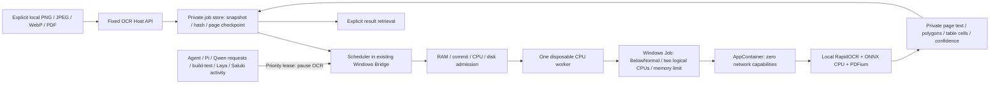

# ローカルOCR（OCR-1実装）

この機能は独立した完全ローカルの文書ジョブです。任意コマンド実行、Cloud Reviewer呼出し、知識の正式採用、コーディングモデル設定の変更はできません。導入・資格確認と実行は別工程です。専用Host設定がない場合、または`enabled=false`なら無効です。

## 構成



新しいサービス・DBは導入しません。既存Bridgeがスケジューラーの生存期間を管理します。OCRモデルは1ページごとに読み込み、プロセス終了で解放します。Windows Jobはプロセス生成時に割り当て、所有Hostの終了時に配下を終了し、1プロセスだけを許可します。workerにはネットワーク資格がなく、Python側のsocket拒否とtelemetry無効化も追加対策です。既存認証情報やユーザーホームはworkerへ許可しません。ACLの許可対象は新OCR資産と正確なジョブディレクトリだけで、後片付けでは今回のランダムなプロファイルの項目だけを除きます。

## 対応範囲とエンジン選定

採用エンジンはRapidOCR3.9.2、ローカルに固定したPaddleOCR PP-OCRv5 mobileの検出・認識モデルと固定ローカル分類器、ONNXRuntime CPUです。PP-OCRv4日本語認識とTesseract native5.0.0（NuGetラッパー5.2.0）も比較しました。選定根拠は上流の性能宣伝ではなく実際の公開fixtureの結果です。

| プロファイル | 対応範囲 | 制限 |
|---|---|---|
| PRINTED_TEXT | 横書き日本語・英語・数字・句読点、PNG/JPEG/WebP | 信頼度は未校正のスコアであり、事実の正しさの証明ではありません。 |
| PDF_DOCUMENT | スキャン・テキスト・混在PDFを1ページずつ描画 | 元PDFにOCR層を書き戻しません。全ページを画像OCRします。任意レイアウトの保証はありません。独立パーサーとレンダラーで入力のCropBox/MediaBoxが食い違う場合は`PDF_RENDER_BOX_MISMATCH`で拒否します。測定した回転・切抜きfixtureは、表示領域外を黙って認識せず未対応とします。 |
| TABLE_LAYOUT | 単純な罫線表と測定済み結合見出し1例。行・列・結合・セル、CSV/Markdown | 一般の罫線なし表や入れ子・複雑レイアウトは未資格として明示します。 |
| AUTO | 印刷文字OCRと単純罫線表の検出 | 自動LLM補正・外部代替・知識採用はしません。 |
| HANDWRITING | 明示的に実験利用へ同意した場合のみ | 過去の手書きかなサンプルは品質基準を満たしませんでした。現代の手書き氏名・住所・帳票・自由文は未資格です。常に`needs_review=true`です。 |

縦書き・強い回転文字は未資格で、形状から検出できた場合は明示します。低信頼度文字は`[判読不能]`とし、別ラベルで推測候補を示します。白紙・文字未検出は確認が必要な警告で、文書が空である証明ではありません。実装完了という言い方で手書き精度不足を隠しません。

測定した公開fixtureには日本語・ASCII記号、合成の傾斜写真、WebP、90度回転、縦書き、罫線あり・なし・結合表、2ページスキャンPDF、ラベル付き公開KMNISTくずし字かながあります。生成印刷画像は実際の手書き・カメラ写真のベンチマークではありません。KMNISTのCC-BY-SA-4.0の出典表示と変換は別途記録します。少数サンプルでモデル品質全体は保証しません。

## 日本語認識の文字集合

CTCデコーダーは出力ラベルをASCIIと日本語JIS X 0213の文字集合（`euc_jis_2004`）へ制限します。ハングルと注音符号を明示的に除外し、日本語文字集合外の中国語文字形はデコード前に除外します。中国語と共通する日本語の漢字は残します。これは文字方針であり、漢字だけの任意文章の言語を判別する保証ではありません。固定済みPP-OCRv5の重み、CPU設定、オフライン実行は維持します。

除外ラベルのスコアが最も高い場合、弱い日本語候補へ無理に置換せず、CTCのblankとして競合させます。該当行に`[対象外文字あり]`、ページに`NON_JAPANESE_CANDIDATE_EXCLUDED_VERIFY_SOURCE`と`needs_review=true`を記録します。除外した元ラベルを本文・候補・表・Slackのテキスト添付へ残しません。スコアを再正規化したり、品質保証へ格上げしたりしません。既存完了結果は保持し、新しいページ処理へ適用します。

## 固定Host API

初期のローカル通信は機械可読なHost CLIです。論理操作`ocr_submit`、`ocr_status`、`ocr_result`、`ocr_cancel`、`ocr_resume`を`localbrain ocr submit|status|result|cancel|resume`へ対応させます。汎用ターミナルツールではありません。この変更ではSlack API・Bot・HTTPアップロード・Continue画像UIを導入しません。

```powershell
# Put an explicitly selected input in the configured OCR inbox first.
$inbox = Join-Path $env:LOCALAPPDATA 'LocalBrain\control-plane\ocr\inbox'
.\tools\ocr\Invoke-Ocr.ps1 -Operation submit -InputFile "$inbox\document.png" -RequestId 'ocr_document_0001' -Profile PRINTED_TEXT
.\tools\ocr\Invoke-Ocr.ps1 -Operation status -JobId '<returned job_id>'
.\tools\ocr\Invoke-Ocr.ps1 -Operation result -JobId '<returned job_id>' -OutputFile '.\private-ocr-result.json'
.\tools\ocr\Invoke-Ocr.ps1 -Operation cancel -JobId '<returned job_id>'
.\tools\ocr\Invoke-Ocr.ps1 -Operation resume -JobId '<returned job_id>'
```

submitは正確な要求ID、SHA256、プロファイル、実験・保持フラグ、Host設定を結び付けます。完全に同じ再要求は同じジョブを観測し、同一要求IDの入力変更は拒否します。元のファイル名は一般ログへ入れません。`input_file_ref`は外部から意味を読み取れないOCRジョブ参照です。statusはページ数・進捗・エラーコード・結果参照・スケジューラー有無・スナップショット削除待ち等のメタデータだけを返します。`OCR_HOST_NOT_RUNNING`は投入を保存したが既存Bridgeスケジューラーが起動していない状態です。非公開OCR本文を返すのは結果取得だけです。構造化応答は`result.schema.json`で定義します。

`queued`と`paused`は完了ではありません。結び付けられた結果がある`complete`だけを結果として取得できます。取消は永続化します。リソース・優先処理による一時停止はアイドル時に自動再開し、完了ページのハッシュを保持します。OCRには外部副作用がないため、中断した未確定ページは再処理する場合があります。同じPIDと**起動時刻**の生きたworker/Hostを推測で終了扱いしたり重複起動したりしません。失敗ジョブには調査と明示再開が必要です。入力・資産・ページ証跡の変更は安全側で拒否します。

## 座標と不確実性

ページ番号と行・列番号は0始まりです。画像の多角形は元画像の端の画素座標を左上原点で表し、EXIF変換を逆変換します。PDFの多角形は描画した**表示ページのポイント座標**を左上原点で表し、ページ回転を記録します。PDF本来の左下原点座標とは主張しません。ラスター寸法と表示座標からの倍率を含めます。モデルが識別していないブロック・段落は捏造せずnullです。

各spanは本文、任意の推測、4点多角形、外接矩形、スコア、`needs_review`、`unreadable`、null可能な表所属情報を持ちます。罫線セルは行・列番号と結合範囲を保持します。CSVは数式らしい値に接頭辞を付け、Markdownは縦棒をエスケープします。生の本文は信頼できない文書内容であり、指示・shellコマンド・自動AIプロンプトにしてはいけません。

## 制限・優先度・保存期間

初期workerは論理CPU2、BelowNormal、同時1ジョブ・1プロセス、ページ実行60秒と別に有限の準備期限（最低60秒、優先処理で中断可能）を使います。入力25MiB、画像20MP・1辺10000px、PDF200ページ・1ページの描画16MP、ページ出力8MiB・ページJSON合計6MiB、非公開保存上限1GiB、別枠のディスク空き128MiBを設定します。保存rootと資産を分離し、入力・ジョブmanifest・ページ確定・最終結果をハッシュで結び付けます。未知の既存証跡は上書きせず保持して拒否します。RAM・commit閾値とworkerメモリ上限は保存済み実測リソース証跡へ結び付け、停止中モデルの空きRAMだけで決めません。

Agent/Piのタスク実行期間、ビルド・テスト振分け、Bridgeモデル要求、Laya、TaskMemory予測は、メタデータだけの優先リースを取得します。重要処理をOCR待ちにしません。スケジューラーは準備中とworker実行中50msごとに確認し、所有workerを終了・メモリ解放してページチェックポイントを保持します。要求の合間に直ちに再起動しないよう5秒の無処理期間を設けます。資産のハッシュは優先確認を挟み64KiBずつ読み、Hostヒープへモデル全体を読みません。版付き配備では旧利用元の実行パスを列挙でき、未計測の旧利用元が生存する間はOCRを停止します。RAM・commit圧迫や持続する高CPUでも停止します。未知・未計測の外部負荷はリソース受付で追加保護しますが、無関係な全プロセスをLocalBrainタスクとして分類できるとは主張しません。

既定では完了・取消後に入力スナップショットを削除します。開いたファイルとの競合は完了結果を維持し、成功を失敗へ変えず、有限の再試行マーカーを記録します。ユーザーの入力元は削除しません。結果・ページと失敗復旧データは作成後24時間で期限切れとなり、Host方針は1..168時間です。削除は次の有効Hostスケジューラー処理時で、PC電源断中には行いません。明示的`RetainOriginal`でも所有コピーを同じ期限までだけ保持します。意図したエクスポートは適切な非公開場所へ保存してください。エクスポート済みファイルはユーザー所有で自動削除の対象外です。通常のCanonical/SecondBrain履歴へOCR本文は渡しません。専用イベントはジョブID・状態・コード・時刻だけで、要求・作業・ページデータは非公開OCR領域だけに置きます。

## 依存関係と導入

`requirements-win-py312.lock`は実行時24パッケージと公式PyPI wheelのハッシュを固定し、`dependencies.lock.json`は版・URL・ライセンス情報を記録します。`models.lock.json`は公式RapidAIモデルレジストリーのURL・サイズ・SHA256を固定します。実行環境は信頼できるPython3.12.14 x64の専用コピーで、子プロセスを起動するvenvランチャーではありません。既存Python・モデルのパスやACLは変更しません。

資産導入は明示的な別操作と新しい配置先を必要とします。

```powershell
python .\tools\ocr\provision.py --build '<new OCR asset directory>' --provision-network
python .\tools\ocr\provision.py --verify-only '<OCR asset directory>'
```

固定した信頼できるPython版を使います。この操作は公開依存・モデルを取得する場合がありますが、OCR起動や機能有効化はしません。実行時にpipやモデル取得経路はありません。実行時manifestとライセンス表示は配布物に保持します。RapidOCR/PaddleOCRはApache-2.0で、Python・ONNXRuntime・PDFium・推移的依存にはそれぞれの表示が必要です。想定した上流の不足ファイル名ではなく、実際に配置したファイルと同梱ライセンスを配布の証跡とします。

## 資格確認・導入・復元

有効化には実ローカルOCR・オフライン隔離、位置・品質・制限、単一ジョブ・優先度・取消・再開、Host障害復旧、リソース・干渉測定、既存Client回帰が必要です。このリポジトリ文書は配備・完了を断言しません。日付付き導入記録、試験・発行DLLのハッシュ、資格確認報告が正本です。Host強制終了と公開fixtureから、実PC再起動、任意手書き、一般的な攻撃耐性を推定してはいけません。

固定manifestを使って新しい版付きOCR実行環境・資産ディレクトリへ導入し、以前のランチャー・MCP設定を保存します。Qwen/Saluki/Laya設定をすべて保持します。通常回帰に合格した同じDLLと正確な資産・設定ハッシュを事前配置へ結び付け、既存Bridge/Agentがアイドルのときだけ有効化します。既存VS Code MCPは実行先変更後に公式Reload Windowが必要です。成功と推定するために旧worker・記録・UACを再起動してはいけません。

この版の復元手順では最初にOCRを無効化し、既存workerを取消・観測して停止を確認します。既知の旧ランチャー・MCP設定ハッシュと既存の旧実行環境だけを戻します。Canonical DBや非公開知識を復元・削除しません。未知の同時変更は調査用に保持します。非公開OCRデータは保持・エクスポート方針に従い、Gitや復元パッケージへコピーしません。

## 将来のアダプター

Slack/Continueアダプターは、所有する検証済みローカル入力参照・正確なSHA256・冪等な要求IDで、同じ固定OCR操作を呼ぶ必要があります。認証済みの出所を結び付け、Host境界で`external_ai=deny`を強制します。難易度振分けと外部送信許可は別です。画像・本文の外部AI送信、方針変更、汎用shell実行の許可として要求本文の指示を受け入れてはいけません。この変更自体にはアダプター、Slack結果返信の許可、SecondBrain採用経路は含めません。

参照元：[RapidOCR](https://github.com/RapidAI/RapidOCR)、[PaddleOCR PP-OCRv5](https://github.com/PaddlePaddle/PaddleOCR/blob/main/docs/version3.x/algorithm/PP-OCRv5/PP-OCRv5.md)、[Tesseract](https://github.com/tesseract-ocr/tesseract)、[KMNIST](https://github.com/rois-codh/kmnist)、[Windows AppContainer](https://learn.microsoft.com/en-us/windows/win32/secauthz/implementing-an-appcontainer)、[Windows Job Objects](https://learn.microsoft.com/en-us/windows/win32/procthread/job-objects)。

### 統合監査候補：大画像と表構造

モデル、CPU2、同時1、AppContainerの通信遮断、Windows Jobの704MiB上限、ページ60秒を維持します。大画像の認識は原画素の960px core＋128px haloで逐次実行し、罫線検出は最大1600pxのプレビューに制限します。座標はEXIF／PDFの元座標へ戻します。タイル継ぎ目や小文字は要確認です。

構造化JSONを正本とし、複数罫線表、結合セル、cell ID、座標、認識信頼度、判読不能・候補文字を保持します。罫線なしは3行以上の安定した列配置だけを推定し、`aligned_text_inferred_verify_before_use` と明記します。構造信頼度は未校正の数値を作らずnullと要確認情報で表します。HTMLは静的・エスケープ済みで、JavaScriptや外部リソースを含みません。Markdownで表現できない結合はJSONと注記へ保持します。

公開合成fixtureの限定資格であり、一般の財務資料、小さすぎる文字、歪み・複雑な結合、任意の回転、手書きの品質を保証しません。XLSXは追加依存とセル型・数式対策の独立検証が必要なため今回追加しません。CSVは補助出力です。
