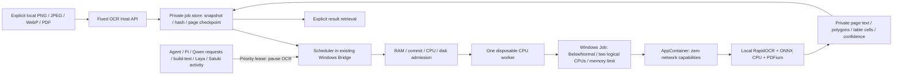

# Local OCR (OCR-1 implementation)

This feature is a separate, fully local document job. It cannot execute arbitrary commands, call a cloud reviewer, promote knowledge, or change coding-model settings. Installation and qualification are separate from runtime execution. The feature is disabled when its dedicated Host configuration is absent or `enabled=false`.

## Architecture



No new service or database is introduced. The existing Bridge owns the scheduler lifetime. OCR models load for one page and unload with the process. The Windows Job attaches at process creation, kills its members if the owning Host dies, and allows only one process. The worker has no network capability; Python-level socket rejection and disabled telemetry are additional controls. Existing credentials and user home are not granted to the worker. ACL grants apply only to the new OCR assets and the exact job directories, then remove only this random profile's entries.

## Supported scope and engine choice

The selected engine is RapidOCR3.9.2 with locally pinned PaddleOCR PP-OCRv5 mobile detection/recognition and the fixed local classifier, ONNXRuntime CPU. Compared alternatives were PP-OCRv4 Japanese recognition and Tesseract native5.0.0 (NuGet wrapper5.2.0). The engine choice is based on actual public fixture results, not upstream capability claims.

| Profile | Scope | Limitations |
|---|---|---|
| PRINTED_TEXT | Horizontal Japanese, English, digits and punctuation; PNG/JPEG/WebP | Confidence is an uncalibrated score. It is never proof of factual correctness. |
| PDF_DOCUMENT | Scan/text/mixed PDF rendered one page at a time | No OCR layer is written back to the original. All pages are raster OCR. No guarantee for arbitrary PDF layouts. A source CropBox/MediaBox discrepancy between independent parser and renderer is rejected as `PDF_RENDER_BOX_MISMATCH`; the measured rotated+cropped fixture is unsupported rather than silently recognizing outside the visible crop. |
| TABLE_LAYOUT | Simple ruled grids and one measured merged-header case; row/column/span/cells, CSV/Markdown | General unruled tables, nested/complex layout are unqualified and flagged. |
| AUTO | Printed OCR plus simple ruled-grid detection | No automatic LLM correction, external fallback or knowledge adoption. |
| HANDWRITING | Explicit experimental opt-in only | Historical handwritten-kana sample failed quality qualification. Modern handwritten names, addresses, forms and free text are unqualified. Always `needs_review=true`. |

Vertical/strongly rotated text is unqualified and flagged when its geometry is detected. Low-confidence text becomes `[判読不能]` with a separately labelled hypothesis. Blank/no-detected-text is a review warning, not proof that a document is empty. Poor handwriting accuracy is not hidden by calling the implementation complete.

Measured public fixtures include Japanese/ASCII symbols, synthetic skewed photograph, WebP, 90-degree rotation, vertical text, ruled/unruled/merged tables, two-page scan PDF and labelled public KMNIST cursive kana. Generated print is not a genuine handwriting or camera-photo benchmark. KMNIST's CC-BY-SA-4.0 attribution and transformation are recorded separately. A small sample does not establish general model quality.

## Japanese recognition vocabulary

The CTC decoder restricts output labels to ASCII and the Japanese JIS X 0213
repertoire (`euc_jis_2004`). Hangul and Bopomofo are explicitly excluded. Chinese
forms outside that Japanese repertoire are excluded before decoding. Japanese
kanji shared with Chinese are retained; this is a character policy, not a promise
to identify the language of an arbitrary Han-only sentence. The pinned PP-OCRv5
weights, CPU settings and offline execution remain unchanged.

When an excluded label wins, its score competes as CTC blank rather than forcing
a weaker Japanese replacement. Affected lines include `[対象外文字あり]`, the page
records `NON_JAPANESE_CANDIDATE_EXCLUDED_VERIFY_SOURCE`, and `needs_review=true`.
Excluded original labels are not retained in text, hypotheses, tables or Slack
text attachments. Scores are not renormalized or promoted to a quality guarantee.
Existing completed results are preserved; this policy applies to new page work.

## Fixed Host API

The initial local transport is the machine-readable Host CLI. The logical operations are `ocr_submit`, `ocr_status`, `ocr_result`, `ocr_cancel`, `ocr_resume`, mapped to `localbrain ocr submit|status|result|cancel|resume`. This is not a generic terminal tool. No Slack API, Bot, HTTP upload endpoint or Continue image UI is installed by this change.

```powershell
# Put an explicitly selected input in the configured OCR inbox first.
$inbox = Join-Path $env:LOCALAPPDATA 'LocalBrain\control-plane\ocr\inbox'
.\tools\ocr\Invoke-Ocr.ps1 -Operation submit -InputFile "$inbox\document.png" -RequestId 'ocr_document_0001' -Profile PRINTED_TEXT
.\tools\ocr\Invoke-Ocr.ps1 -Operation status -JobId '<returned job_id>'
.\tools\ocr\Invoke-Ocr.ps1 -Operation result -JobId '<returned job_id>' -OutputFile '.\private-ocr-result.json'
.\tools\ocr\Invoke-Ocr.ps1 -Operation cancel -JobId '<returned job_id>'
.\tools\ocr\Invoke-Ocr.ps1 -Operation resume -JobId '<returned job_id>'
```

Submit binds the exact request ID, SHA256, profile, experimental/retention flags and Host configuration. Exact retry observes the same job; changed content under the same request ID is rejected. The original filename is not placed in the general log. `input_file_ref` is an opaque OCR job reference. Status contains metadata only, including page count/progress/error code/result reference, scheduler presence and pending snapshot cleanup. `OCR_HOST_NOT_RUNNING` means that submission was saved but no existing Bridge scheduler is running. Result retrieval is the only operation returning private OCR text. `result.schema.json` describes the structured response.

`queued` and `paused` are not completion. Only `complete` with a bound result is readable as a result. Cancellation is durable. Resource/priority pauses resume automatically when idle; completed page hashes are preserved. Interrupted uncommitted pages may be processed again because OCR has no external side effect. An existing live worker/Host with the same PID **and creation time** is never guessed dead or duplicated. Failed jobs require inspection and explicit resume. Changed input/assets/page evidence fail closed.

## Coordinates and uncertainty

Page numbers and row/column indexes are zero-based. Image polygons use the original image's edge-pixel coordinates, top-left origin; EXIF transforms are inverted. PDF polygons use rendered **display-page points**, top-left origin, with page rotation recorded. They are not claimed to be native PDF bottom-left coordinates. Raster dimensions and the display-to-raster scale are included. Blocks/paragraphs that the model does not identify remain null rather than fabricated.

Each span has text, optional hypothesis, four-point polygon, bounding box, score, `needs_review`, `unreadable`, and nullable table membership. Ruled cells retain row/column indexes and spans. CSV prefixes formula-like values; Markdown escapes pipes. The raw text is still untrusted document content and must not become instructions, shell commands or an automatic AI prompt.

## Limits, priority and retention

Initial worker uses two logical CPUs, BelowNormal priority, one job/process, page worker execution timeout60s plus a separately bounded preparation phase (at least60s, interruptible by priority), input25MiB, images20MP/10000px edge, PDF200 pages/render16MP per page, per-page8MiB output and aggregate page JSON6MiB, private storage quota1GiB and a separate128MiB free-disk reserve. Root and assets must be disjoint. Input/job manifests, page commits and final results are hash-bound; unknown existing evidence is preserved and rejected rather than overwritten. RAM/commit thresholds and worker memory ceiling must be tied to the saved measured resource evidence; they are not derived from the stopped model's free RAM alone.

Agent/Pi task lifetime, build/test router, Bridge model requests, Laya and TaskMemory prediction acquire metadata-only priority leases. Important work does not wait for OCR. The scheduler checks during preparation and every50ms while the worker runs, terminates its owned worker, releases memory, then preserves page checkpoints. A five-second quiet period prevents immediate restart between important requests. Asset hashing streams through64KiB buffers with priority checks, so it does not load model files into the Host heap. Versioned deployment can list legacy consumer executable paths; OCR remains paused while those old, uninstrumented consumers remain alive. RAM/commit pressure and sustained high machine CPU also pause it. Unknown/uninstrumented external workload is additionally guarded by resource admission; it is not claimed that every unrelated process can be classified as a LocalBrain task.

Default input snapshot is removed after completion/cancel; an open-file deletion conflict retains a completed result and records a bounded retry marker instead of changing success to failure; the user's source file is never removed. Result/pages and failed-job recovery data expire24h after creation (Host policy1..168h). Expiry occurs on the next enabled Host scheduler pass, not while the PC is off. Explicit `RetainOriginal` retains the owned copy only until the same expiry. Keep any export intentionally in an appropriate private location; exported files are user-owned and outside automatic cleanup. General Canonical/SecondBrain history receives no OCR body. Dedicated OCR events contain only job ID/state/code and time; request/scratch/page data live only in the private OCR store.

## Dependencies and provisioning

`requirements-win-py312.lock` pins all24 runtime packages and official PyPI wheel hashes; `dependencies.lock.json` records versions, wheel URLs and licence metadata. `models.lock.json` pins official RapidAI model registry URLs, bytes and SHA256. The runtime is a dedicated copy of trusted Python3.12.14 x64, not a child-spawning venv launcher. Existing Python/model paths and ACLs are not modified.

Provisioning requires an explicit separate action and a new destination:

```powershell
python .\tools\ocr\provision.py --build '<new OCR asset directory>' --provision-network
python .\tools\ocr\provision.py --verify-only '<OCR asset directory>'
```

Use the pinned trusted Python version. This operation may download public dependencies/models; it starts no OCR and enables no feature. Runtime has no pip/model-download route. Runtime manifests and license notices must be retained with a distribution. RapidOCR/PaddleOCR are Apache-2.0; Python, ONNXRuntime, PDFium and transitive packages retain their own notices. The actual staged files and bundled licenses, not an assumed upstream missing filename, are the distribution evidence.

## Qualification, installation and rollback

Feature enabling requires actual local OCR/offline isolation, position/quality/limits, one-job/priority/cancel/resume, Host-crash recovery, resource/interference measurements and existing Client regressions. This repository document does **not** assert deployment or completion: the dated installation receipt, tested/published DLL hashes and qualification report are authoritative. Real PC reboot, arbitrary handwriting and general attack resistance must not be inferred from Host-kill and public fixture tests.

Install into a new versioned OCR runtime/assets directory with pinned manifests and backup the previous launcher/MCP config. Preserve all Qwen/Saluki/Laya settings. Stage must bind the same DLL that passed the ordinary regression and the exact asset/config hashes. Activate only while existing Bridge/Agent tasks are idle. Existing VS Code MCP processes need the official Reload Window to pick up a changed runtime. No old worker/receipt/UAC is relaunched to infer success.

Rollback first disables OCR, cancels/observes its existing worker, and verifies the worker is gone. Restore only the known old launcher/MCP configuration hashes and existing previous runtime. Do not restore/delete Canonical DB or private knowledge. Unknown concurrent changes are preserved for inspection. Private OCR data follows its retention/export policy rather than being copied into Git or rollback packages.

## Future adapters

Slack/Continue adapters should call these same fixed OCR operations with a validated owned local input reference, exact SHA256 and idempotent request ID. Adapters must bind authenticated origin and force `external_ai=deny` at the Host boundary. Difficulty routing is independent of data-egress permission. They must not accept a request-body instruction as permission to send an image/text to an external AI, alter the policy or invoke a generic shell. This change implements no adapter, no Slack return-message permission and no SecondBrain adoption path.

Upstream references: [RapidOCR](https://github.com/RapidAI/RapidOCR), [PaddleOCR PP-OCRv5](https://github.com/PaddlePaddle/PaddleOCR/blob/main/docs/version3.x/algorithm/PP-OCRv5/PP-OCRv5.md), [Tesseract](https://github.com/tesseract-ocr/tesseract), [KMNIST](https://github.com/rois-codh/kmnist), [Windows AppContainer](https://learn.microsoft.com/en-us/windows/win32/secauthz/implementing-an-appcontainer), [Windows Job Objects](https://learn.microsoft.com/en-us/windows/win32/procthread/job-objects).
