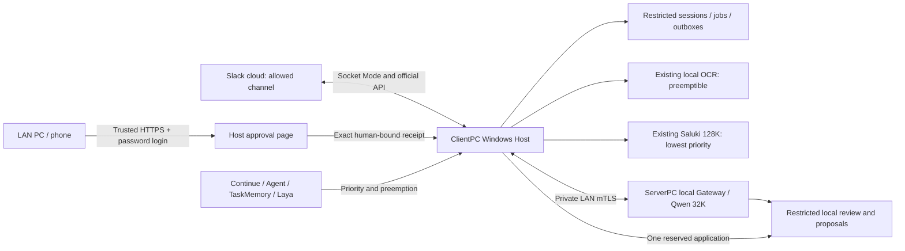

# Slack連携

公開テンプレートでは既定で無効です。別途運用者が承認した環境では、実際の公開Slackメンション・受付・完了返信を確認済みです。配備・実動資格確認と、このDraft PRのマージは別であり、PRで別環境を自動有効化しません。既存のコーディング・OCR・TaskMemory・Laya設定を保持します。確認範囲と残る条件は`SLACK_VALIDATION.md`を参照してください。

## 境界

ClientPCはSocket Mode受付、制限付きSQLiteのSession/Job/送信待ち保存、認証済みHTTPS承認を管理します。ServerPCは認証済みローカル低優先度推論とローカルReviewerを提供します。Slack要求にはterminal・Git・コード編集・管理者操作・外部レビュー・Cloud代替の権限はありません。

派生記録はすべて`origin=slack`、`data_class=slack_restricted`、`external_ai=deny`、`cloud_fallback=false`を維持します。Slack状態と入出力は、リポジトリ・通常のTaskMemoryコーパス・SecondBrain自動採用から分離します。通常作業のレビュー振分けは維持します。Slack自体はCloudサービスで、画像投稿はSlackへのアップロードです。ローカルAI処理にしてもそのアップロードを取り消すことにはなりません。

## データと権限の流れ



図は実装済みの任意利用経路です。公開テンプレートは無効のままで、別途承認した環境では公開テキストだけのSlack往復を確認しました。アップロードはSlackのCloudに保存されますが、OCR・ローカル推論・要約・非公開の結果/提案保存で外部AIは使いません。承認画面はClientPCで動きます。ServerPC Chatのサイドバーから信頼したHTTPSアドレスへ直接リンクし、HTTP Chatを承認プロキシにはしません。承認済み環境では既存ページを再読込すると新規チャットボタンの下にリンクが表示されます。

## Slack管理者の設定

1. `tools/slack/app-manifest.yaml`で内部Slack Appを作成し、Socket Modeを有効化して`connections:write`付きApp-Level Tokenを作成します。
2. 対象ワークスペースへ導入し、許可する唯一の公開・非共有チャンネルへBotを招待します。DMや他チャンネルは受理しません。
3. 実team ID・channel ID・bot user IDを取得します。表示名ではなくIDで許可し、イベント受信前に`auth.test`と`conversations.info`で識別情報・所属を確認します。
4. 無効状態の設定テンプレートをGit外のHost所有の非公開ディレクトリへコピーし、パスとIDを置換します。ローカルWindows端末で`Set-SlackTokens.ps1`を実行します。トークンは隠して入力し、ユーザー/SYSTEMだけが読めるファイルへ保存します。チャット・コマンド・画像・Gitへ貼らないでください。
5. 両候補の統合確認と、実行環境・復元計画の承認が完了するまで機能を無効にします。

購読は`app_mention`だけで、毎要求に明示的な`<@BOT_USER_ID>`が必要です。manifestは`app_mentions:read`、`channels:read`、`chat:write`、`files:read`、`files:write`を要求します。権限変更後はAppを再インストールします。履歴スキャンや任意URL取込の権限は要求しません。

## 永続受付と復旧

許可済みワークスペース・チャンネル・スレッドの組が1つの共有論理Sessionです。開始者に関係なく、人間の参加者なら明示的メンションで継続できます。開始者は作成者メタデータで、アクセス制限ではありません。Job・履歴には実際の要求者を保持し、要約にもユーザーIDを含めて参加者を区別します。前の画像OCRは同じSession内だけで再利用し、別スレッド・チャンネル・ワークスペースへ渡しません。スレッド内の順序と管理者承認要件は維持します。受理イベントは一意のevent IDと別返信キューでSQLiteへ確定します。受付文はメンション・全体通知なしの正確な`受け付けました。`です。その配送記録前にはOCR・推論を開始しません。完了時は元スレッドで要求者をメンションします。

過去のチャンネルスキャンからJobを生成しません。認証済みSocket Mode接続ごとに新しいオンライン受付境界を作り、それ以前のSlack時刻を持つ未知イベントは、停止・再接続中の滞留分も含めて無視します。永続受理済みJobは別の規則で復旧します。保守的な境界により短い再接続中の投稿や時計ずれで受付を見送る場合もあるため、Host時計を同期してください。ネットワーク・停止の全タイミングを完全には推定できません。

既知のレート制限は`Retry-After`に従います。投稿応答が曖昧、または送信中に障害が起きた場合は、重複投稿せず`uncertain`にします。認証済み承認画面で曖昧な配送を一覧化し、管理者が確認後に正確なSlack投稿時刻を記録できます。不明な投稿を自動再送しません。配送を確定できなければ保留して調査し、新規要求を作る前に確認します。`client_msg_id`は安定させますが、無期限のexactly-once保証とは扱いません。

## ローカルOCRと会話

許可チャンネルの認証済みfile IDを`files.info`で解決します。Slackの認証済み非公開ダウンロード元にある、上限内の画像・PDFだけを許可し、リダイレクト・任意URL・外部ファイル・未対応形式を拒否します。元ファイルとOCR JSONは制限領域へ保持します。既存のOCRチェックポイント・復旧・資格確認済みプロファイルを再利用し、手書き・縦書き・任意帳票の未資格という制限も維持します。

OCR原文とモデルの解釈は分けます。ファイル由来の応答は同Sessionの後続会話も含め既定でローカル保存とし、Slackには完了通知と処理IDを返します。添付の準備処理は抽出本文を最大48,000 UTF-8バイト許容しますが、対応する現Server契約は描画済み入力フィールド合計で最大16,000 UTF-8バイトです。対応予算を超えた入力は黙って切り詰めずローカル失敗とします。大文書の階層的要約はこの実装では未資格です。

## 優先度・コンテキスト・保持期間

前面のContinue/Agent/新しいCriticと重要なTaskMemory/Layaを優先します。Slack OCRは既存の中断可能スケジューラーを使います。Slack Qwenの同時実行は1件で、背景処理はHost活動とリソース受付を確認します。Serverは実推論の受付時に優先度を強制し、Clientだけのbusy確認では不十分です。承認済み公開の通常/背景/前面確認では、所有する背景処理の中断と前面処理の完了を確認しました。限定的な公開試験であり、一般的な処理能力の保証ではありません。

Salukiは既存の検証済み128K/CPU6/parallel1/GPU0/KV-q8エンジンと排他的バックエンドリースを使います。背景要約は重要処理へ譲り、所有するバックエンドを解放して原履歴を保持します。保守的なUTF-8上限見積りで設定可能な8K入力予算付近に圧縮を要求し、Server側でも対応する描画入力上限を強制します。実際の制限付き履歴のSaluki要約品質・遅延・リソース利用は未資格です。要約の出所は変更不可の完了履歴へ結び付け、原文を置換しません。

日次整理は30日間非活動のSessionを削除します。保存領域に起因する圧迫時には7日超の古いSessionから削除し、圧迫解消で止めます。進行中Job・未配送返信は保護し、CPU負荷だけではSessionを削除しません。Clientは期限切れの提案/レビュー・推論入力も削除し、ハッシュだけの監査を残します。未解決の適用記録は照合完了までSessionを保護します。正式採用済み制限付き知識はServerPCに保持します。冪等なServer終了処理は未採用の実行・提案本文を削除し、正式知識・Rule状態・採用監査を残します。公開fixtureで契約を確認していますが、実両端の終了処理は配備確認条件です。

## LAN HTTPSでの人間承認

権限の正本はClientPC Windows Hostです。信頼する専用LAN HTTPS URLの`/slack/approvals`へ直接アクセスし、HTTPリダイレクトやメニューに信頼を依存させません。既存ServerPC Chatは登録URLへリンクできますが承認主体ではありません。

実際のLAN DNS/IP SANを持つ、信頼済みの専用CAサーバー証明書を使います。端末はサーバーCAを信頼する必要がありますが、管理者クライアント証明書は不要です。証明書警告を無視してはいけません。各端末は設定したプライベートサブネット内に置き、実到達性や携帯での使いやすさは実機確認が必要です。Internet/VPN/ポート転送の入口は導入しません。ローカルの`tools/slack/Set-ApprovalPassword.ps1`でGit外に認証ファイルと対応Web設定を準備します。既知の旧設定ハッシュを要求し、既存ファイルを保護します。

承認待受にはHTTPSと管理者パスワードログインが必要です。サイト選択方針は4～256文字を許容し、ランダムsalt付きPBKDF2-SHA256（600,000回）のハッシュだけを保存し、失敗回数によるロックは設けません。Secure/HttpOnly/SameSite=StrictのCookieは1時間で期限切れとなり、ログアウト・パスワード変更・受信Host再起動でも終了します。同一originのCSRF、提案内容ハッシュ、期限、再利用防止の確認は必須です。信頼しない提案本文はテキストとして描画し、ログへパスワード・本文・証明書・トークンを残しません。Host承認と正式適用は別で、`approved`は`applied`ではありません。承認は正確なCanonical要求を原子的に予約し、既存Host mTLS証明書・管理者・提案/レビュー/対象/基準/新版ハッシュ・nonce・5分期限へ結び付けます。別workerが1回だけ送信します。曖昧応答はServerの読み取り状態で照合し、不明・中断結果はHOLDのまま再実行しません。採用済み項目も制限付き保存領域に残し、通常SecondBrain知識にはしません。

任意のユーザーセッション通知監視は一般的な保留通知だけを表示します。session 0ではなく、ログイン中Windowsセッションで動かします。通知を見逃しても承認一覧が正本です。

## 復元

モデル・認証設定は変更しません。Slack機能を無効化し、通常のサービス/タスク手順でその所有プロセスだけを止めます。SQLite・返信キュー・不明な適用記録を保持し、正確な配備記録の旧バイナリへ任意Client/Server入口を戻します。不明な送信・適用の再実行や通常Canonical DBの復元はしません。PRは自動マージしません。

## 公式参照

- [SlackのSocket Mode](https://docs.slack.dev/apis/events-api/using-socket-mode/)
- [SlackのAppメンション](https://docs.slack.dev/reference/events/app_mention/)
- [Slack投稿とレート制限](https://docs.slack.dev/reference/methods/chat.postMessage/)
- [Slack非公開ファイルの認証](https://docs.slack.dev/reference/objects/file-object/)
- [ASP.NETの証明書認証](https://learn.microsoft.com/en-us/aspnet/core/security/authentication/certauth?view=aspnetcore-10.0)

## 資格確認後の候補起動

`localbrain slack verify --config <private-slack-config.json>`は、受付有効化・Socket Mode接続・投稿・OCR起動・推論要求なしに、現在のBot識別情報と許可チャンネルを確認します。`enabled`がfalseでも動作し、固定状態と活動件数0だけを出力します。チャンネル・ファイルのメタデータには公式GET通信を使い、認証情報はAuthorizationヘッダーだけへ入れます。必須のチャンネル安全フラグがなければ拒否します。

Client実行ファイルには.NET 10とASP.NET Core 10共有ランタイム、または対応する自己完結型発行物が必要です。配備前に確認してください。開発PCには両方あります。公開テンプレートに認証情報はありません。配備条件を満たすまで`enabled`とServerの`human_apply_enabled`をfalseにします。Git外の非公開設定ディレクトリで既存Hostを使います。

```powershell
localbrain slack serve --config <private-slack-config.json> --web-config <private-approval-config.json>
```

この単一所有者が受付・返信キュー・処理・背景保守・承認適用・HTTPSを管理します。既存Bridge/OCRサービスを置換・再起動しません。`host.lock`で2つ目のSlack所有者を防ぎます。既存Bridge OCRスケジューラーは資格確認済み設定で稼働している必要があります。任意の通知監視はユーザー対話セッションで別実行します。このPRはWindowsサービス、ファイアウォール開放、証明書登録、予定タスクを導入しません。

Server非公開設定では実設定のHost所有者とHost mTLS証明書指紋を使います。公開fixtureの識別情報は本番用ではありません。Server通信はprivate IPv4、既存HTTPS検証、プロキシなし、リダイレクトなしに制限します。通常Client要求はこの任意通信を生成しません。Client HTTPSは`/slack/approvals`に対応し、元の`/`も同じログイン・承認画面を返します。

### テキストのファイル返却

`returnFileResults`は任意利用で、公開テンプレートでは既定falseです。有効時には完了OCRのMarkdown再現を`ocr-<job-id>.md`として元チャンネル・スレッドへ添付します。明示的な文字起こしはQwenの解釈を省略します。解析要求には追加で`analysis-<job-id>.txt`を返します。返却先は元のSlackスレッドだけで、Cloud AI/OCRは使いません。依頼された添付をSlack自体へ送信します。

永続ファイル送信キューは、Slackアップロードチケット取得・バイト列アップロード・共有確定の前に、内容と送信先を固定します。既知のレート制限は延期し、ネットワーク・完了結果が曖昧なら自動再送せず保持します。pending/uncertainファイルはSessionの保持期間整理から保護します。非公開のアップロード資格や本文をログ・公開物へ出しません。

明示承認した既存完了ジョブでは、`localbrain slack return-ocr-text --config <private-config> --job <job-id>`で常駐する単一Hostへローカル要求を渡せます。保存OCRを再利用し、OCR・推論を再実行しません。同じ操作を繰り返すと既存要求を観測し、送信済み最終ファイルは再送しません。ローカルOCR結果は非公開OCRジョブ領域とSlack保存領域へ保持します。

## レビューと公開状態

正確な公開試験範囲と未資格条件は`SLACK_VALIDATION.md`を参照してください。承認済み環境で実公開メンション受付・ACK・完了返信が成功しました。Client確認と通常回帰、Server全公開回帰、限定的独立SSEレビュー、認証済みcapabilities、公開優先度・完了確認、ローカルのパスワード認証HTTPS確認を記録しています。実Slackファイル/OCR、再接続・再起動復旧、制限付きSaluki要約、実知識/Rule適用・保持期間、携帯実機、広範なリソース性能は未資格です。実装範囲はmainに対するレビュー可能状態ですが、有効化は別の運用判断で、マージしても別環境を変えません。ローカル障害時にCloud AIへ切り替えません。

## 現環境の運用資格確認

Appを導入・招待し、認証情報をローカルの隠し入力で設定し、承認済みの単一受信Hostがオンラインです。人間が新規投稿した公開メンションで、永続Job・受付・完了返信が各1件、期待マーカー一致を確認しました。その確認で不明配送・重複Jobはありません。先の失敗公開イベントは保持し、再実行していません。

Serverストリーム解析は妥当なrole/finish/usageメタデータを受理し、不正フレーム・サイズ・完了・取消の確認を維持します。修正後、上限付き公開の制限要求が成功しました。観測した文字返信不具合の修正であり、任意添付や一般モデル品質の保証ではありません。

承認済みServerは検証済みHost認証Chatに限り任意のローカルモデル自動起動を有効にします。公開の停止→準備完了→完了確認は推論1回で成功しました。自律レビュー・status・capabilitiesはモデルを起動せず、不明要求を無条件に再試行しません。公開テンプレートの既定は無効です。

承認済み環境では、人間承認付き制限知識と列挙されたSlack応答Ruleの適用も有効です。候補は採用せず蓄積できます。パスワードログイン後、管理者が正確な内容とローカルレビューを確認して明示承認し、認証済みHostが提案/レビュー/対象/基準/新版ハッシュ・nonce・期限へ結び付けます。実Host capabilitiesは人間適用有効で、自動採用・通常SecondBrain採用・外部AI・Cloud代替はfalseです。ClientPCからChat入口・HTTPSログイン・未認証拒否を確認しました。試験で実非公開提案の採用や本番Rule変更はしておらず、他端末の実承認は未資格です。

環境固有のタスク・ファイアウォール・証明書・認証・有効化変更はローカル運用記録に保持し、Gitへコピーしません。公開テンプレートは無効のプレースホルダーであり、非公開設定・原メッセージ・OCR結果・生成回答は公開成果物ではありません。

アップロード前の既知API拒否を修正した後は、運用者が`slack retry-ocr-ticket --config <private-config> --job <job-id>`を使えます。remote file ID・upload URLがなく、OCRバイト列が不変の保留チケットだけを戻します。不明なアップロード、完了済み・曖昧な共有は戻せません。

### Slackの既定の添付形式

画像・PDFの解析依頼では、既定で `analysis-<job-id>.html` だけを添付します。読み取り根拠のOCR結果はローカルに保持し、`ocr-html-<job-id>.html` は自動では併送しません。明示的な文字起こし・表の再現だけの依頼では、Qwenによる解釈を省き、OCR結果のファイルを返します。保存済みOCRの明示的な取出し操作と、明示依頼されたJSON/CSVの追加出力は維持します。

画像・PDFのOCRと、そのスレッド内で続けて依頼した解析結果は、HTMLを優先して添付します。HTMLとして安全に構成できない場合やHTMLが添付サイズ上限を超える場合は、Markdownへ切り替えた旨を元スレッドへ通知します。利用者がMarkdownを明示した場合は、その指定を優先します。HTMLとMarkdownを既定で両方送ることはありません。

代替時のファイル名は解析が `analysis-<job-id>.md`、文字起こしが `ocr-<job-id>.md` です。Markdownも1MiBの添付上限を超える場合は、切り詰めたり別形式へ黙って変更したりせず、ページ・表を分けて依頼するよう通知します。既に配送・保留・不明状態として固定された旧成果物は、この既定値変更だけで削除・作成・再送しません。

構造化JSONは「JSON形式も添付してください」などの明示依頼がある場合だけ追加します。表が検出されただけではJSONを追加しません。「JSONは不要」「JSONではなくHTML」も識別します。CSVも表データと明示依頼がある場合だけ追加します。「HTMLで」「HTML形式で」のように形式名の後ろへ日本語が続く依頼を認識します。

OCRのHTMLは保存済みの構造化結果から生成し、表・結合セル・数字の配置と要確認情報を保持します。追加依頼でモデルがHTMLを返した場合も、実際の `.html` 文書として保存します。形式指定のために新しい画像を添付し直す必要はありません。追加JSON/CSVの参照元は同じSessionに保存されたOCR結果だけです。通常の文字だけの会話は、HTML/Markdownを明示しない限りSlack本文の返信を維持します。

HTMLは静的な安全形式です。モデルから来た任意のJavaScript・外部リソース・CSS・URL属性は実行用として引き継がず、Hostの固定スタイルとCSPを使います。解釈できないHTMLは本文を失わない安全なMarkdownへ切り替えます。OCRの推測候補は `[推測]`、候補がない判読不能箇所は `[判読不能]` を保持し、形式を変えるために文字や表を推測し直しません。各ファイルの既存1MiB上限は維持し、切詰めません。Markdownも上限を超える場合は分割依頼を案内します。

旧 `.txt`・`.md`・`.html` の配送済み・保留中・送信状態不明のファイル名、内容、送信先を保持します。既定形式の変更や再起動だけで旧ファイルを作り直したり再送したりしません。アップロード前に明確に拒否されたチケットだけは、既存の限定操作で元の形式・バイト列のまま回復できます。DBスキーマ、OCRモデル、認証、外部AI禁止、保存期間は変更しません。

### 要約待ちからの復旧

CPU受付は250ms窓の測定を再利用し、時間0・単一tickのサンプルを100%負荷と解釈しません。RAM/commitと前面リースは毎回確認し、サンプル更新を同期します。要約を待つ受理要求のSessionを、任意の知識候補抽出より優先します。元要求と原履歴は保持します。

要約の試行はハッシュ化Session識別情報と固定進捗コードだけを記録します。重複しない進捗メッセージ1件で、ローカル履歴要約中と元の要求者へ知らせます。起動待ちを含む操作期限は900秒、前面処理による取消は即時です。ネイティブ完了には固定120秒でなく既存のトークン数依存期限を使い、CPU/RAM制限・モデルコンテキスト・認証・Cloud AI方針は緩めません。

圧縮閾値は背景処理の目安であり返信の必須条件ではありません。完全なコンテキストが既存16,000バイト上限に収まれば直接送ります。単一Hostが不要だった旧要約待ちを入力識別情報を変えず再検討します。本当に超過する要求は結び付いた要約を待ち、実行中の背景要約は実行可能なユーザー作業が現れれば譲ります。

### Slack応答の期限（候補・切替前）

新規設定の推論許容は最大120秒、Clientの外側期限は指定値+5秒、Chat通信期限は125秒です。Serverは入力量に応じて30〜120秒に制限し、呼出し側の指定を超えません。既存の30秒設定や固定済みrequestは書き換えず、設定移行は別途切替時に行います。foreground優先・中断後の再送禁止・外部AI禁止は維持します。

### 統合監査候補：復旧・構造化成果物

新しい推論だけを `inference_progress` へ登録し、論理Jobと最大3回のAttemptを区別します。通信断やHost再起動後は認証済みstatusとrequest hashを照合し、終了・単一slot待機・不変入力を確認する新Server契約がある場合だけ再開します。旧凍結要求や状態不明は自動再送しません。照会失敗は30秒間隔・20回までで保留し、保留通知は一度だけ記録します。

Slackの既定返却はHTML優先・困難時Markdownです。構造化JSON/CSVは明示依頼がある場合だけ追加します。詳細は「Slackの既定の添付形式」を参照してください。旧配送のファイル名・内容・送信先・uncertain状態は変更しません。

`allowSharedThreads` の既定値は `true` で現行の共有スレッド動作を維持します。`false` は最初の依頼者だけが同じSessionを継続できる候補です。今回の指示書と従来の共有指定が異なるため、本番設定の変更は別途決定・承認が必要です。

OCR単体は既定24時間です。Slackが受領した結果・成果物はSlack専用DBに保存され、Sessionの30日期限と容量条件に従います。元OCRの24時間経過後も保存済みSlack成果物を参照できる場合があります。進行中Job・未確定配送は保護し、容量圧迫時の早期Session削除は7日超の非活動Sessionだけです。利用者がエクスポートしたファイルはSession削除では回収しません。
