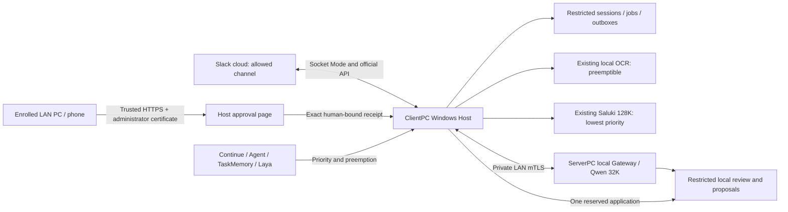

# Slack integration

This feature is disabled by default. Deployment, real Slack connectivity and physical LAN/mobile qualification are separate from public automated tests. The existing coding, OCR, TaskMemory and Laya settings are preserved.

## Boundaries

ClientPC owns Socket Mode intake, the restricted SQLite session/job/outbox store and authenticated HTTPS approval. ServerPC provides authenticated, local, lower-priority inference and local Reviewer operations. A Slack request has no terminal, Git, code-editing, admin, external-review or cloud-fallback capability.

Every derived record remains `origin=slack`, `data_class=slack_restricted`, `external_ai=deny`, `cloud_fallback=false`. Slack state and input/output stay outside repositories, the ordinary TaskMemory corpus and automatic SecondBrain adoption. Ordinary work retains its review routing. Slack itself is a cloud service: posting an image in Slack uploads it to Slack; local AI processing does not undo that upload.

## Data and authority flow



This diagram describes the disabled candidate path. Slack itself stores uploads in its cloud; OCR, local inference, summaries and private result/proposal storage do not use external AI. The approval page runs on ClientPC. The legacy ServerPC HTTP menu is only a link to its trusted HTTPS address.

## Slack administrator setup

1. Create an internal Slack app using `tools/slack/app-manifest.yaml`. Enable Socket Mode and create an app-level token with `connections:write`.
2. Install the app in the intended workspace. Invite the bot to the sole permitted public, non-shared channel. No DM or other channels are accepted.
3. Obtain the real team ID, channel ID and bot user ID. Authorize IDs, never display names. `auth.test` and `conversations.info` verify identity and membership before receiving events.
4. Copy the disabled settings template to a private Host-owned directory outside Git. Replace paths/IDs. Run `Set-SlackTokens.ps1` in a local Windows terminal; token entry is concealed and saved in user/SYSTEM-only files. Never paste tokens in chat, commands, screenshots or Git.
5. Keep the feature disabled until both Client and Server candidates have passed their integration checks and the runtime/rollback plan has been approved.

The bot subscribes only to `app_mention`; explicit `<@BOT_USER_ID>` is required on every request. The manifest requests `app_mentions:read`, `channels:read`, `chat:write`, and `files:read`. It does not request history scanning or arbitrary URL ingestion.

## Durable reception and recovery

One thread identifies one logical session. Only its initiating user may continue it. Each accepted event is committed to SQLite with a unique event ID and a separate reply outbox. The exact acceptance text is `受け付けました。`, without a user mention or broadcast. OCR/inference wait until its delivery has been recorded. Completion mentions the requester in the original thread.

No historical channel scan generates jobs. Each authenticated Socket Mode connection has a fresh online acceptance boundary. Unknown events whose Slack message timestamp predates that boundary are ignored, including shutdown/reconnect backlog. Already persisted jobs are recovered independently. This conservative boundary may also decline an event sent during a short reconnect gap or affected by clock skew; synchronize the Host clock. It cannot perfectly infer every network/shutdown timing case.

Known rate limits honor `Retry-After`. An ambiguous post response or crash during sending becomes `uncertain` instead of blindly posting a duplicate. The authenticated approval page lists ambiguous deliveries and allows an administrator to record the exact remote Slack post timestamp after verifying it. It never automatically resends an uncertain post. If delivery cannot be established, leave it held and investigate before making a new request. `client_msg_id` is stable, but is not treated as an unlimited exactly-once delivery guarantee.

## Local OCR and conversation

Authenticated file IDs from the allowed channel are resolved through `files.info`. Only bounded image/PDF files on Slack's authenticated private download origin are allowed; redirects, arbitrary URLs, external files and unsupported formats are rejected. Originals and OCR JSON are retained in the restricted store. Existing OCR checkpoint/recovery and qualified profiles are reused; handwriting/vertical text/arbitrary forms retain their existing unqualified limits.

OCR plaintext and model interpretation are separate. File-derived responses, including later conversation in that session, remain local by default; Slack receives a completion notice and processing ID. The attachment staging guard allows up to 48,000 UTF-8 bytes of extracted text, but the current paired Server contract accepts at most 16,000 UTF-8 bytes of combined rendered input fields. Inputs exceeding the paired budget fail locally instead of silently truncating them. Large-document hierarchical summarization is not qualified by this implementation.

## Priority, context and retention

Foreground Continue/Agent/Fresh Critic and important TaskMemory/Laya work take precedence. Slack OCR reuses the existing preemptible scheduler. Slack Qwen concurrency is one; background work checks Host activity and resource admission. The Server must also enforce priority at actual inference admission; a Client-only busy check is insufficient.

Saluki uses the existing verified 128K/CPU6/parallel1/GPU0/KV-q8 engine and exclusive backend lease. Background summarization yields on important activity, releases its owned backend and preserves original history. A conservative UTF-8 upper bound triggers compression near the configurable 8K input budget; the Server must enforce its exact Qwen 32K rendered token budget. Summary provenance binds to immutable completed history; summaries never replace originals.

Daily cleanup removes inactive sessions after 30 days. Storage-attributable pressure can remove oldest sessions older than seven days, stopping when pressure recovers. Active jobs/undelivered replies remain protected. CPU load alone never deletes sessions. Client cleanup also removes expired local proposal/review and inference-input payloads, retaining hash-only audit. Unresolved application receipts protect their session until reconciliation. Formally accepted restricted knowledge stays on ServerPC; the idempotent Server retirement endpoint removes unadopted run/proposal payloads while preserving formally accepted knowledge, Rule state and adoption audit. Public fixtures verify this contract; real paired retirement remains a deployment gate.

## Human approval over LAN HTTPS

ClientPC Windows Host is the authority. Use a dedicated LAN HTTPS URL ending in `/slack/approvals` directly; do not depend on an HTTP redirect/menu for trust. The existing ServerPC chat can link to the registered URL but is not an approval authority.

Use a trusted private-CA server certificate with the actual LAN DNS/IP SAN, plus separately enrolled administrator client-auth certificates. Import the CA trust and administrator client identity into each authorized PC/iPhone/Android using the organization's approved device process. Never bypass certificate warnings. Each device must be on the configured private subnet; actual reachability and mobile certificate selection need physical verification. No Internet/VPN/port-forwarding endpoint is installed.

The approval listener requires TLS, exact enrolled client-certificate SHA256 and client-auth EKU, a short-lived Secure/HttpOnly/SameSite=Strict cookie, same-origin CSRF token, proposal content hash, expiration and replay checks. Untrusted proposal text is rendered as text. Server logs omit request bodies, certificates and tokens. Host approval is distinct from formal application; an `approved` item is not an `applied` item. Approval atomically reserves an exact canonical request, bound to the Host mTLS certificate, administrator, proposal/review hashes, target/base/new hashes, nonce and five-minute expiration. A separate worker dispatches it once. Ambiguous responses are reconciled through read-only Server status; unknown/interrupted results remain HOLD and are never replayed. Accepted items remain in restricted storage and are not ordinary SecondBrain knowledge.

The optional user-session notification watcher displays only a generic pending notice. Run it in the logged-in Windows session, not session 0. The approval list remains authoritative when a notification is missed.

## Rollback

Do not change model/auth settings. Disable the Slack feature and stop only its owned process using the normal service/task lifecycle. Preserve its SQLite/outbox and unknown application receipts. Return the optional Client/Server entrypoints to their prior binaries from the exact deployment receipt. Do not replay unknown sends/applies or restore the ordinary canonical database. PRs are not auto-merged.

## Official references

- [Slack Socket Mode](https://docs.slack.dev/apis/events-api/using-socket-mode/)
- [Slack app mentions](https://docs.slack.dev/reference/events/app_mention/)
- [Slack message posting and rate limits](https://docs.slack.dev/reference/methods/chat.postMessage/)
- [Slack private file authentication](https://docs.slack.dev/reference/objects/file-object/)
- [ASP.NET certificate authentication](https://learn.microsoft.com/en-us/aspnet/core/security/authentication/certauth?view=aspnetcore-10.0)

## Candidate launch after qualification

The Client executable now requires both the .NET 10 runtime and ASP.NET Core 10 shared runtime (or a matching self-contained publish); verify them before deployment. Both are present on the development PC. The public templates contain no credentials. Keep both `enabled` and the Server's `human_apply_enabled` false until the deployment gates are satisfied. In a private, non-Git configuration directory, use the existing Host executable with:

```powershell
localbrain slack serve --config <private-slack-config.json> --web-config <private-approval-config.json>
```

This single owner runs intake, reply outbox, processing, background maintenance, approval application and HTTPS. It does not replace or restart the existing Bridge/OCR service. The `host.lock` prevents a second Slack owner. The existing Bridge OCR scheduler must be running with its qualified configuration. The optional notification watcher runs separately in the interactive user's session. No Windows service, firewall opening, certificate enrollment or scheduled task is installed by this PR.

Use the real existing Host owner (`pc73-windows-host`) and Host mTLS certificate fingerprint in the Server's private settings; public fixture identities are not production identities. The Server connection is restricted to private IPv4, existing HTTPS certificate validation, no proxy and no redirects. Ordinary Client requests do not instantiate this optional transport. Client HTTPS supports `/slack/approvals`; the original `/` also serves the same authenticated page.

## Review and release status

See `SLACK_VALIDATION.md` for exact public test coverage and unqualified gates. Real Slack App/channel/files behavior, physical phones, real model contention/throughput, independent review, and live paired retention/purge remain release blockers. This is an unmerged Draft PR, not an activated production Slack deployment. A failed local process never falls back to Cloud AI.
